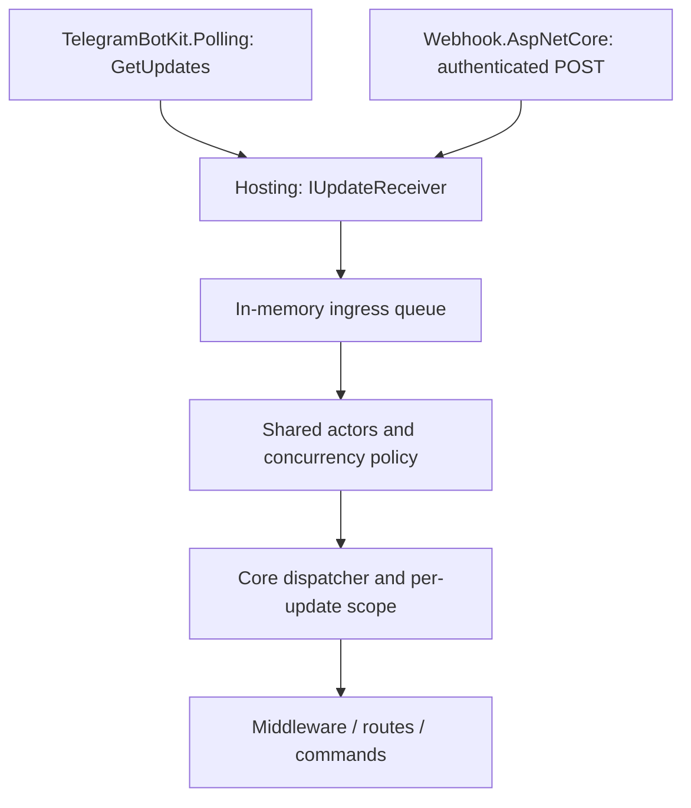

# ASP.NET Core webhooks

The working tree provides `TelegramBotKit.Webhook.AspNetCore` for an existing
ASP.NET Core application. This is a new package for the next release; installing
the currently published 0.4.0 preview does not provide these APIs.

```csharp
using TelegramBotKit.DependencyInjection;
using TelegramBotKit.Hosting;
using TelegramBotKit.Webhook.AspNetCore;

var builder = WebApplication.CreateBuilder(args);
builder.Services.AddTelegramBotKit(o =>
    o.Token = builder.Configuration["TelegramBotKit:Token"]!);
builder.Services.AddCommands();
builder.Services.AddTelegramBotKitUpdateProcessing(configure: o =>
    o.MaxDegreeOfParallelism = 8);
builder.Services.AddTelegramBotKitWebhook(o =>
{
    o.Path = "/telegram/update";
    o.SecretToken = builder.Configuration["Webhook:SecretToken"]!;
    o.Url = builder.Configuration["Webhook:Url"]!;
});
var app = builder.Build();
app.MapTelegramBotKitWebhook();
await app.RunAsync();
```

Keep bot tokens and webhook secrets in configuration secrets or environment
variables. The endpoint requires a 1–256 character secret consisting of ASCII
letters, digits, underscores or hyphens. It checks the
`X-Telegram-Bot-Api-Secret-Token` header using a constant-time comparison.
The route allows anonymous ASP.NET authentication and disables antiforgery;
Telegram's secret header authenticates delivery. Application endpoint conventions
and upstream request limits still apply.

`Path` is local to the application or mapped route group. `Url` is the externally
reachable HTTPS address, including any proxy or route-group prefix. Configure
HTTPS/reverse proxy routing in the host. `Url` can be empty when the application
only receives updates and another deployment component manages registration.

## Explicit management

Registration and deletion are deliberate operations, never automatic host
startup/shutdown side effects:

```csharp
await app.Services.SetTelegramBotKitWebhookAsync();
// When intentionally switching back to polling:
await app.Services.DeleteTelegramBotKitWebhookAsync();
```

Registration uses `Url`, `SecretToken`, `AllowedUpdates`, `MaxConnections` and
`DropPendingUpdates`. Deletion preserves pending updates unless explicitly called
with `dropPendingUpdates: true`. Starting or stopping a replica does not change
the bot's remote webhook. Do not enable polling and webhook in the same runtime;
registration rejects this combination. Across separate processes, deployment
must also prevent competing delivery modes.

Telegram's connection limits, secret format, HTTPS requirements and mutual
exclusion with GetUpdates are described in the
[official Bot API](https://core.telegram.org/bots/api#setwebhook).

## Reception and execution



The adapters await receiver admission, not handler completion. HTTP 200 and
advancing a polling offset therefore mean acceptance by the configured receiver.
The default receiver retains work only in memory: no durable admission,
deduplication or retry is promised. A crash after acknowledgement can lose work.
Duplicate update IDs are not suppressed. Inbox/outbox remain separate future
packages; this change does not implement them or change QueuedMessageSender.

The ingress pump enters scheduling in admission order. Built-in normal scheduling
preserves that order within an actor key. Concurrent HTTP requests do not establish
Telegram chronological order. Custom scheduled dispatchers control when they
submit work and must document their policy. Callback/user keys and unkeyed updates
follow the same rules as polling. An active built-in conversation response can
bypass the occupied actor and global slot; otherwise a waiting command would
prevent its own response from being processed.

The HTTP cancellation token controls admission only. Accepted work uses the
shared execution lifetime and its own Core scope, independent of HttpContext.
Stopping the host cancels and awaits accepted work before disposing scheduler
resources. Handlers must cooperate with cancellation. Shutdown cancels pending
work rather than promising successful completion; it does not persist it.

Queues are currently unbounded. The concurrency setting limits active handlers,
not memory consumption or ingress backlog. Horizontal replicas have independent
actors and waiters; this implementation does not provide cross-process ordering
or persisted conversations.

## HTTP responses

| Status | Meaning |
| --- | --- |
| 200 | Receiver accepted the update; handlers may still be running. |
| 400 | Invalid JSON, invalid update_id or Telegram.Bot deserialization failure. |
| 403 | Missing or incorrect secret header. |
| 405 | Unsupported HTTP method. |
| 413 | Body exceeds MaxRequestBodyBytes (default 1 MiB), with or without Content-Length. |
| 415 | Content type is not JSON. |
| 503 | Shared receiver is stopped or canceled independently of the request. |

Unexpected receiver failures propagate through ASP.NET error handling; no success
is sent when admission fails. Validation accepts unknown future update fields
and is not a complete Telegram schema validator. Core still requires an
appropriate descriptor/handler to process additional update types.

Run [the webhook sample](samples/webhook.md)
for complete local configuration instructions.

## Polling migration

Polling has moved from `TelegramBotKit.Hosting` to `TelegramBotKit.Polling`.
Replace the package reference and `using TelegramBotKit.Hosting` with
`using TelegramBotKit.Polling` at polling registration call sites. The method
name `AddTelegramBotKitPolling()` remains the same. Add the Hosting namespace
separately when configuring shared execution.

This package/API move is a source and binary compatibility break relative to
the published preview. Consumers must rebuild against the new package set;
the previous Hosting package cannot forward to Polling without reversing the
intended dependency direction. No version bump or publication has been performed.
PhotoSelector intentionally still exercises published packages and retains the
old reference until its separate migration.

Configure shared concurrency using
`services.Configure<UpdateProcessingOptions>(o => o.MaxDegreeOfParallelism = 8)`
or the shared registration callback above. A null value falls back to the legacy
`TelegramBotKitOptions.Polling.MaxDegreeOfParallelism` for compatibility; zero or
a negative value removes the global limit.

## Validation and review

Solution Release build succeeds with zero errors. The full test run passes
233 Core tests and 10 PhotoSelector tests; PhotoSelector intentionally tests
published packages, not the new local runtime. Existing dependency warnings remain.

| Requirement | Evidence |
| --- | --- |
| Shared pipeline and update scope | `Valid_update_runs_core_pipeline_and_disposes_its_own_scope` |
| Admission independent of slow handlers | `Http_success_does_not_wait_for_synchronous_application_middleware` |
| Conversations remain live at DOP=1 | `Waiting_command_receives_webhook_response_with_DOP_one` and polling conversation tests |
| FIFO admission into one actor | `Receiver_preserves_admission_order_for_the_same_key` |
| Transport-independent concurrency | `Shared_execution_options_override_legacy_polling_concurrency` |
| Accepted work outlives request cancellation | `Accepted_work_outlives_admission_cancellation_and_shutdown_awaits_disposal` |
| Authentication and bounded request bodies | `Missing_or_wrong_secret_never_reaches_receiver`, `Body_limit_applies_with_and_without_content_length` |
| Deliberate management, no hidden network calls | `Webhook_management_is_explicit_and_sends_configured_parameters` |
| No accidental transport mixing | `Polling_and_webhook_cannot_be_registered_together` |

Standards review: no outstanding findings. Spec review: the original per-update
Task.Run ordering issue is fixed by the single-reader ingress pump and covered
by the FIFO regression test. This is not a load or crash-recovery test. No live
Telegram endpoint was contacted; HTTP integration uses ASP.NET Core TestServer
and Telegram management uses a fake HTTP transport.

XML summaries, parameter descriptions, return values and relevant lifetime
remarks accompany the new public receiver, options and adapter APIs. Runtime
NuGet packages include XML documentation beside their DLLs.
